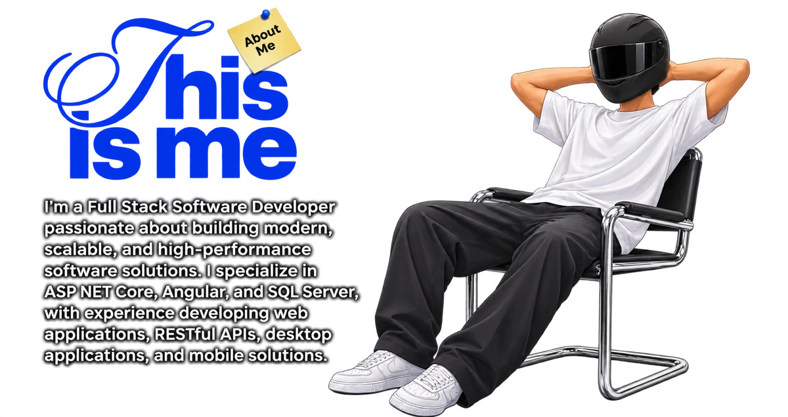
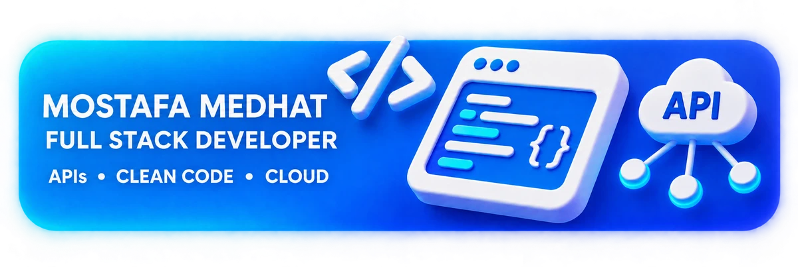
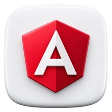
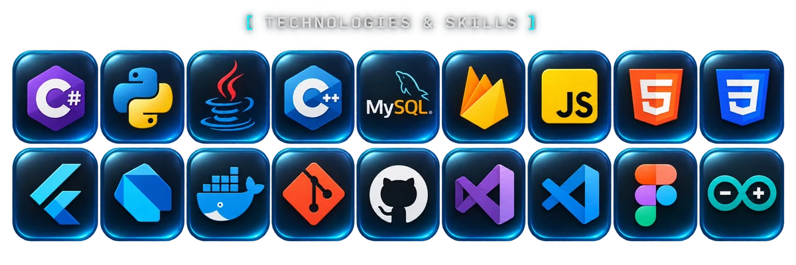

  

  

  

  

    &nbsp;
    &nbsp;
    &nbsp;
    
  

  &nbsp;
  &nbsp;
  &nbsp;
  

## `> featured --open-source`

  <h2>Eye Voice</h2>
  
<strong>Communication beyond touch — an open-source, gaze-controlled assistive communication experience.</strong>

  

  

    Eye Voice turns a standard webcam into an accessible communication interface. It tracks gaze direction in real time, supports dwell-based selection, and helps users build and speak messages without a mouse, keyboard, or touch.
  

  

    <a href="https://mostafamedhat19.github.io/EyeTracking/"><strong>Launch Live Demo</strong></a>
    &nbsp;•&nbsp;
    <a href="https://github.com/MostafaMedhat19/EyeTracking"><strong>View Repository</strong></a>
    &nbsp;•&nbsp;
    <a href="https://github.com/MostafaMedhat19/EyeTracking/blob/main/CONTRIBUTING.md"><strong>Contribute</strong></a>
  

## `> building --with-purpose`

I build full-stack products with **ASP.NET Core, Angular, and SQL Server**, focusing on clean architecture, reliable APIs, and maintainable user experiences. I am especially interested in **accessibility and open-source software** that turns practical ideas into tools people can genuinely use.

## `> stack --full-core`

  <h3>Full Stack Core</h3>

  &nbsp;&nbsp;
  &nbsp;&nbsp;
  

    

  

## `> explore --my-journey`

  

  

    <a href="https://github.com/MostafaMedhat19?tab=repositories"><strong>Projects</strong></a>
    &nbsp;•&nbsp;
    <a href="https://mostafa-portfolio-nine.vercel.app"><strong>Experience &amp; Portfolio</strong></a>
    &nbsp;•&nbsp;
    <a href="https://flowcv.com/resume/fsg5hgs1swr5"><strong>Resume</strong></a>
  

## `> github --analytics`

  

   

  
  

## `> contributions --animate`

  <picture>
    <source media="(prefers-color-scheme: dark)" srcset="https://raw.githubusercontent.com/MostafaMedhat19/MostafaMedhat19/output/github-contribution-grid-snake-dark.svg" />
    <source media="(prefers-color-scheme: light)" srcset="https://raw.githubusercontent.com/MostafaMedhat19/MostafaMedhat19/output/github-contribution-grid-snake.svg" />
    
  </picture>

## `> connect --with-me`

  <h3>LET'S BUILD SOMETHING GREAT</h3>
  
Have an idea, an opportunity, or just want to talk tech? Let's connect.

  &nbsp;
  &nbsp;
  

    

  &nbsp;
  

    

  

