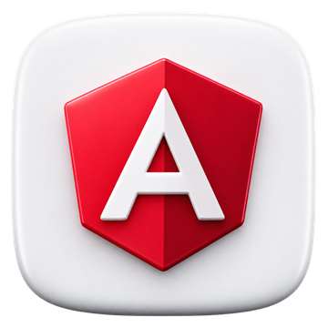
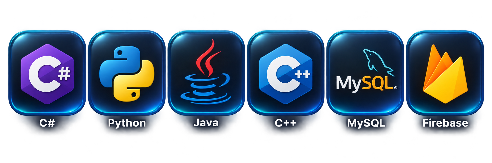
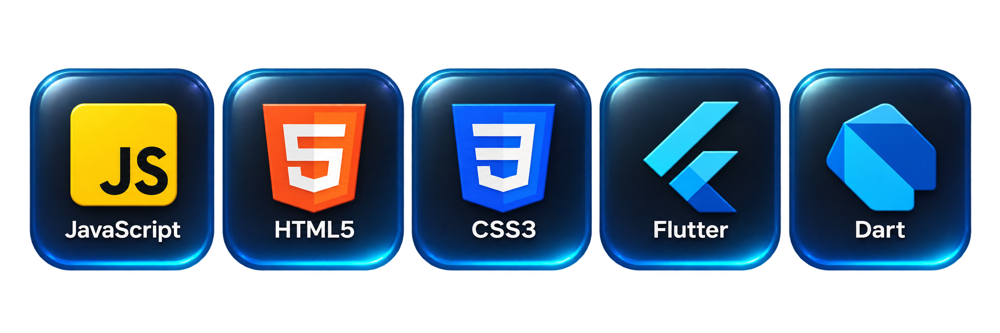
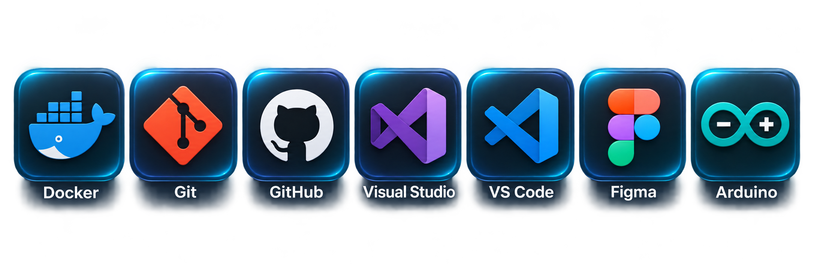
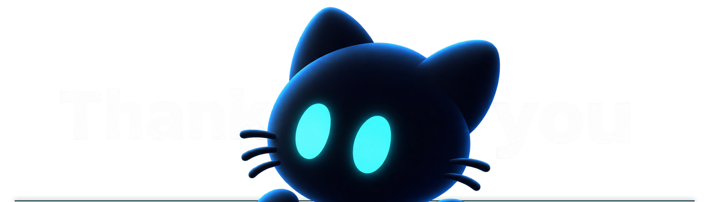

  

  

  

    &nbsp;
    &nbsp;
    &nbsp;
    
  

## `> profile --command-center`

### Hey, I'm Mostafa 👨‍💻

I'm a software developer specializing in **.NET backend development**. I enjoy turning real-world requirements into clean, maintainable, and scalable applications.

- 🔭 Building robust web apps, APIs, desktop, and mobile solutions
- ⚡ Focused on C#, ASP.NET, databases, and system integration
- 🌱 Growing deeper in cloud computing and system design
- 🤝 Open to collaboration on useful, ambitious products

  

  <h3>Full Stack Core</h3>

  &nbsp;&nbsp;
  &nbsp;&nbsp;
  

  
<b>⚙️ Backend & Databases</b>

  

    
  

  
<b>🎨 Frontend & Mobile</b>

  

    
  

  
<b>🛠️ Tools & Workflow</b>

  

    
  

  <h3>GitHub Analytics</h3>

  

   

  
  

## `> explore --my-journey`

  

## `> contributions --animate`

  <picture>
    <source media="(prefers-color-scheme: dark)" srcset="https://raw.githubusercontent.com/MostafaMedhat19/MostafaMedhat19/output/github-contribution-grid-snake-dark.svg" />
    <source media="(prefers-color-scheme: light)" srcset="https://raw.githubusercontent.com/MostafaMedhat19/MostafaMedhat19/output/github-contribution-grid-snake.svg" />
    
  </picture>

## `> connect --with-me`

  <h3>LET'S BUILD SOMETHING GREAT</h3>
  
Have an idea, an opportunity, or just want to talk tech? Let's connect.

  &nbsp;
  &nbsp;
  

    

  

