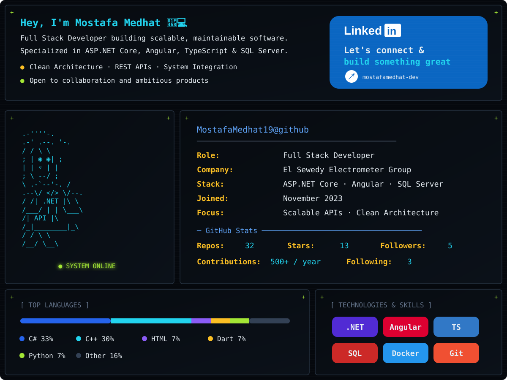

  

  

  

    
    
    
  

## `> profile --command-center`

  

## `> explore --my-journey`

  

## `> contributions --animate`

  <picture>
    <source media="(prefers-color-scheme: dark)" srcset="https://raw.githubusercontent.com/MostafaMedhat19/MostafaMedhat19/output/github-contribution-grid-snake-dark.svg" />
    <source media="(prefers-color-scheme: light)" srcset="https://raw.githubusercontent.com/MostafaMedhat19/MostafaMedhat19/output/github-contribution-grid-snake.svg" />
    
  </picture>

## `> connect --with-me`

  
Have an idea, an opportunity, or just want to talk tech? Let's connect.

  
  
  

    

  

